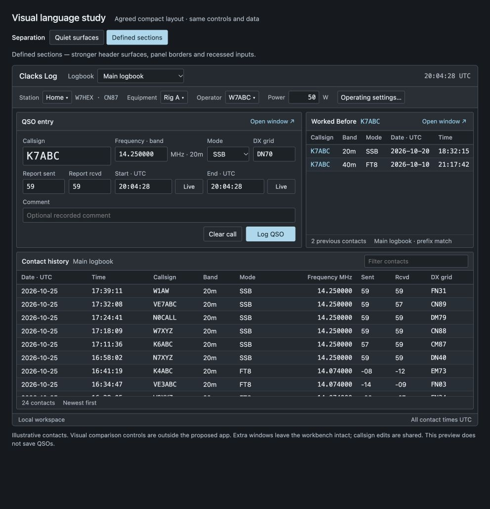

# Desktop workbench and interaction design

This document owns the agreed desktop workbench behavior. The
[desktop foundation](desktop.md) owns runtime and lifecycle behavior;
[operating settings](operating-settings.md) owns station, equipment and
reusable-record semantics; [manual logging](manual-logging.md) owns QSO entry,
editing and deletion; [local history](history.md) owns history, Worked Before
and query behavior; the [product contract](product.md) owns overall scope. These are design requirements for the product,
not a claim that every described view is already implemented.

## Workbench composition

The main window is a compact workbench with the following arrangement:

- QSO entry at the upper left.
- One shared tabbed area at the upper right, containing Worked Before for the
  current callsign and adjacent contact details (D317).
- The current logbook's contact history across the width below those two areas.
- A compact summary of the active station, equipment, operator and transmit
  power above the logging areas.

Use desktop space efficiently and keep useful data visible. The accepted compact
arrangement establishes relative placement and density, without fixing pane
pixel sizes, column widths, font families or a docking system. The visual direction below
governs separation. The shared-component contract below defines common behavior;
exact visual tokens remain implementation design.

This accepted reference fixes the composition: application name and logbook
selection share the in-window toolbar; station/profile, station identity,
equipment, operator, inline power and Operating settings share the operating
strip directly beneath it. Defined sections frame the logging tools below.
The logbook selector and operating summary are chrome, rather than independent
stacked content panels. Preserve that placement and grouping as capabilities
arrive; reducing padding on a different arrangement does not meet this contract.
The illustrated contact data and not-yet-delivered tools remain illustrative.
The [light appearance reference](images/desktop-workbench-light-reference.jpg)
uses the same composition and component hierarchy.

The upper-right area holds Worked Before and additional contact details as
alternative tabs in the same pane. Showing details replaces that pane's Worked
Before content; it does not create a third upper pane or expand the entry form.
Present these controls as a contiguous tab strip with visible surfaces and
boundaries even before hover. The selected tab joins visually to the content
below; inactive tabs must remain obviously clickable.
All tabs share their top and bottom edges and height, including tabs with an
additional action icon. Center icons vertically with the tab label; nested
action controls must not introduce extra tab padding or change its height.
Keep quick entry visible on the left and contact history below. The reference
images establish the visual language and pane placement; the right-hand pane
now includes this tab selection. The
[manual-logging specification](manual-logging.md#2-workbench-and-form-boundaries)
defines the entry fields and detail tabs, with Worked Before supplied by #10.

The delivered history query bar stays inside the history section, below its
toolbar. Its diagnostic/status row retains a fixed line of space during edits;
completion overlays the workbench without resizing its panes. Table headers
and single-line cells fit their allocated rows under the installed theme.
Populating or refreshing a table must not enlarge the user-sized logging pane.

Worked Before presents one row of data per QSO, rather than a multiline card for
each contact. Its callsign-prefix matching, current-logbook scope and handling of
local working versions follow the product contract. Contact history remains a
table of the current logbook's contacts.

### Logbook selection and management

The [logbook setup specification](logbooks.md) consolidates the #8 workflow,
storage boundary and handoff to later entry/history consumers. This section
retains the shared desktop interaction requirements.

Contact navigation includes the built-in **All contacts** and **Untagged** views
alongside named logbooks (D302). All contacts shows each active QSO once;
Untagged shows active contacts with no tags. Neither built-in view is a stored
tag or carries an automatic-upload policy. The [product contract](product.md)
owns these view semantics. When either built-in view is selected, new QSOs
default to untagged (D303); a previously selected named logbook does not remain
as a hidden default. A named logbook supplies its own tag as before.

Changing views also updates the default membership of an unfinished new-contact
entry (D309); do not retain the old view's proposed tag. Preserve its other
entered values. Saved contacts and existing-contact edits are not retagged by
changing views.

Restore the last selected view per workspace on restart (D304), using stable tag
identity for named logbooks. Start new workspaces in All contacts. If the
remembered tag is known to be deleted, open All contacts with an explanation;
temporary loading failures preserve the remembered selection.

Use the same All contacts fallback and explanation if the selected tag is
deleted during use, whether locally or through synchronization (D307). The
fallback changes the selected view and the default for new QSOs, rather than
rewriting saved contacts or repairing pending deleted-tag references.

The selected view is authoritative client-local SQLite state (D308). Read and
change it through the existing asynchronous session/store path. Its deletion
fallback commits atomically with the effective tag deletion; presentation
preferences do not maintain another saved selection.

Use a compact main-window logbook/view selector for immediate switching, with
**Manage logbooks…** in the native **Settings** menu. This placement supersedes
the adjacent management button described in D305. Management opens a dedicated dialog for
named-tag creation, names, per-service automatic-upload policies and deletion;
do not add another permanent management pane. All contacts and Untagged are not
editable tags. Use the shared Save/Cancel, validation and dismissal behavior.
Delete opens a separate impact review showing the three agreed choices and
distinct-contact counts before confirmation.

Show short, collision-checked ID suffixes only when tag display names are
duplicates (D306). Unique names remain unsuffixed. Manage logbooks exposes the
full tag ID for viewing and copying. Keep display disambiguation separate from
the stored name and the full identity used by selection and commands.

### Resizing and reset

Make the divider between QSO entry and the shared tabbed area, and the divider between
the upper pair and contact history, user-resizable (D300). Remember pane sizes
locally on the client. Provide a reset to the default arrangement, with QSO
entry and the shared tabbed area above full-width history. Put the reset action
in **View → Layout**, rather than in the logging region. History fills the entire
remaining width and height below the upper panes, including while loading or
empty; its bounds do not shrink to its controls or row count. Reset changes layout, not
operating settings, contact data, appearance, fonts or selection.

All table views present their entire result set as one continuous scrolling
display, without user-facing pagination controls or page numbers (issue #88).
Internal bounded reads remain invisible to the user. The scrollbar represents
the full result set, including rows whose data has not yet arrived.

Contact history and Worked Before own their complete pane layout: controls and
filter/status at the top, compact counts at the bottom, and a table viewport
filling the remaining bounds. Rows scroll inside that viewport; row count does
not move the fixed controls. Determine usable minimum sizes from the controls
and a table viewport that shows at least one complete row or empty-state message, rather
than having the table estimate space for controls outside it.

The three panes are divisions of the main window: use square corners, no outer
gutter and no enclosing card outlines. Tabs, table surfaces and scroll viewports
fill their pane allocation up to the shared boundaries. Put spacing around form
controls inside the scrollable content, never around the whole pane or outside
its scrollbar. Group form fields with headings and restrained separators rather
than repeated inset cards. The shared divider itself is the resize
target, without a separate handle element. Align the upper panes at their top
and bottom edges, with their outer left and right edges aligned to history.
Splitter containers add no extra padding
or nested section frames. Detail-form groups and text fields use the available
pane width and follow pane resizing rather than retaining a fixed input width.

Use minimum pane sizes that keep controls usable at the selected UI scale.
Reserve the measured width of the complete detail-tab strip, including its
window action, when limiting the divider. The native window minimum must
accommodate both panes and update when typography or display scaling changes.
Restore remembered sizes within the space available in the current window;
old dimensions must not leave a pane inaccessible after display/window changes.
Additional windows retain the independent-view behavior below.

## Contact entry and full editing

The [manual-logging specification](manual-logging.md) consolidates #9's workflow,
validation, save/reset and storage boundaries. This section owns its shared
presentation requirements. Worked Before arrives through #10; #9 uses the same
adjacent area for actual Contact details and Our settings, without placeholder
results or a nonfunctional Worked Before tab.

Quick QSO entry includes an optional contact-name field (D316). Later directory
lookup can supply the displayed name through the existing separate-source
fallback rules; manual name entry remains recorded contact information.
Place Name next to Callsign in quick entry. Field labels state their purpose
without appending “(optional).” Keep start and end entry controls in quick
entry rather than duplicating them in the adjacent details tab. Additional
detail fields, including the contacted operator callsign, are available
directly within their selected tab rather than behind expandable disclosures.

Use this compact entry order and grouping:

- Callsign and Name together at the top.
- Frequency, Band, Mode and DX grid together on the next row.
- Sent and received reports, then the independently controlled Start and End
  timestamps, grouped beneath the radio fields. Each Start/End control combines
  its UTC date and time under the same independent live/locked control.
- Align the Sent and Received input fields. Live/Locked buttons align with and
  occupy the full height of their corresponding timestamp input fields.
  Reserve report-feedback space consistently across edited and unchanged values.
  When the row cannot fit, move Start and End below the reports together; stack
  the timestamp controls when they cannot fit side by side. Keep feedback within
  its field's width.
- A full-width Comment below those fields, followed by local validation/save
  feedback. Keep the QSO entry header outside the scrolling form, with Save QSO
  at its right edge so both remain visible while the form scrolls.

The adjacent area selects Worked Before, Contact details or Our settings.
Contact details contains additional contacted-station/location/reference and
receive information, without repeating the quick-entry identity, grid or time
controls. Our settings keeps own-station, operator, power and equipment values
together for contact-specific corrections. Switching tabs preserves the same
unfinished QSO; Save QSO saves its values across both panes.

Do not make a separate contacted operator callsign a routine part of quick
entry. Retain it as optional secondary detail when independently known, without
requiring it alongside a name or inferring a distinction from the contact call.

Group our station, operator, power and equipment together as the contact's
operating settings in full editing, using ordinary section organization rather
than presenting them as unrelated peer workflows. Editing these contact values
does not change the active operating context.

For unfinished QSOs, use the adjacent tabbed area for additional details rather
than an expandable entry form (D317). Worked Before is one of its selectable
tabs, keeping the upper workbench at two panes. Switching back to Worked Before
does not save the QSO or discard the unfinished contact's details. Quick entry
and its adjacent details concern the same in-progress contact; tab navigation
is distinct from saving it. Saved-contact editing remains separate from the
unfinished new-contact form and retains the shared dialog Save/Cancel rules.

## Additional windows and shared entry

Dedicated QSO-entry and Worked Before windows are additional views. Opening or
closing one leaves the main workbench's visible areas and arrangement intact;
it does not switch the main window into a different mode or relocate its tools.
Worked Before does not expose inline **Open in window** or **Close window**
buttons. Additional windows close through the operating system's window controls.
Open its additional window with an icon inside the Worked Before tab, using a
window outline with an outward upper-right arrow. Give the icon a tooltip and
accessible name. Activating it preserves the selected main-window tab and draft.

All QSO-entry views on one client share the same in-progress contact. Changes to
that contact and its current callsign are reflected in the other entry and
Worked Before views. An extra entry window does not introduce an independent
draft. Existing nonpersistent-draft and successful-save behavior still applies.

## Compact operating summary

The summary shows active values, with selected saved sources distinguished from
unassociated operating values. Keep source-change and equipment-override
indicators consistent with the operating-settings contract.

Provide quick station-profile selection, equipment-configuration selection and
operator changes directly from this summary. Small editors use explicit
Apply/Cancel. Preview the equipment consequence of selecting a station profile:
load its associated default when present, or retain current equipment when no
default is specified. Preserve operator and transmit power on profile/equipment
loads. These actions change current operation, not the saved reusable records.

Transmit power is an inline editable value with a visible watts unit. It requires
no popup or separate Apply button. Enter, Tab or leaving the field commits a
valid value; Escape restores the previous committed value. Accept ordinary
decimal input such as `.5` as 0.5 watts, within native milliwatt resolution.
Blank means absent. Invalid text must not replace active power; preserve the
input and show a useful local error. Changes to power or operator do not detach
station/equipment selections. Computer-aided transceiver control remains
post-MVP; no radio-controlled power workflow is added here.

Place an explicitly named **Operating settings…** action beside these controls,
within the summary group. It opens a dialog for full editing. Avoid an ambiguous
“Edit all…” action separated from the values it affects.

## Full editing and persistence boundaries

The operating-settings dialog retains one pending context across its station,
equipment and operator/power views, with one Apply/Cancel pair. The compact
summary continues to represent applied operation. Manual adjustments detach
only the affected station/equipment selection as specified by D285; operator
and power remain separate. Saved-source changes and deletion retain their
existing comparison, stale-save and cleanup rules.

Reusable station-profile and equipment-configuration editors remain separate
from current-operation editing. Saving them does not implicitly apply, load or
select their values. Quick changes and full-dialog application affect future
operating defaults; they do not rewrite historical QSO snapshots.

## Visual language

Use **Defined sections** (D289): panel headers, restrained borders and recessed
editable controls make tool boundaries and inputs apparent while retaining the
compact workbench density. Carry this hierarchy across the workbench, dialogs
and additional windows. Avoid turning each data item into a separate card.

The references establish the surface palette, relative typography, control
treatment and action emphasis as well as the hierarchy. Translate those roles
into native egui styles and shared components; keep the selected egui/eframe
architecture and normal framework interaction behavior. Pixel dimensions and
browser markup are implementation details, while the visual relationships carry
across native rendering, appearance choices and scaling.

The current shared palette uses these surface and emphasis roles:

| Role | Dark | Light |
| --- | --- | --- |
| Workspace canvas | `#1d2228` | `#f0f1f5` |
| In-window toolbar, section body, dialog | `#252a30` | `#ffffff` |
| Operating strip and raised headers | `#2a2f35` | `#f0f1f5` |
| Recessed fields and value controls | `#1d2226` | `#f5f6f8` |
| Restrained border | `#49525b` | `#cbd1d8` |
| Primary text | `#e4eaef` | `#1e272f` |
| Secondary text | `#b5c0cb` | `#52616c` |
| Primary action and focus accent | `#add6e7` | `#326781` |

Controls use small corners and thin outlines, with distinct native hover, focus,
selection and disabled states. Primary Save/Apply actions use the accent fill
and a contrasting foreground; secondary actions retain the quieter control
treatment. Edited and error colors retain their independent state meanings.

The in-window toolbar retains the logbook selector and direct access to conflict
resolution through **Unsynchronized changes**. Preserve existing synchronization
status in its current location, including the workspace-status footer. Move
management commands into OS-native menus using the following agreed structure:

| Native menu | Commands |
| --- | --- |
| Edit | Select all (focused text or all matching history contacts across pages) |
| Settings | Manage logbooks…, Station profiles…, Equipment configurations…, Refresh settings, account/server management, WS Suite…, Appearance… |
| View | Reset workbench layout |
| Help | Workspace & diagnostics… |

**WS Suite…** opens the shared receiver-settings dialog. **Receive WS Suite
updates** enables its pending Unicast/Multicast fields; **Apply** commits and
activates them without restarting. Unicast has Local address and Port;
Multicast has Group address, Port, Network interface and Refresh interfaces.
A new workspace starts disabled with a loopback unicast proposal. The multicast
group must be supplied by the operator. Current local interfaces show their OS
name and address, with System default available where scope permits.

Use the existing 300 ms validation, field errors, unapplied-value treatment,
Apply/Cancel and opener-focus rules. Disabled connection fields do not block
applying Off. The checkbox and unapplied treatment convey normal configuration;
there is no separate Off/Listening status or endpoint summary. A reception
failure has its own actionable message, retained outside a dismissed dialog
with direct settings access. Apply can retry unchanged failed settings. A
successful retry clears that message and closes the dialog; another failure
keeps it open. Closing or cancelling does not undo an already submitted Apply.

Use the native menu bar, including the screen-level menu bar on macOS; an egui
menu drawn in the toolbar is not a substitute. Do not create a separate Logbooks
menu. A single-entry menu is appropriate only when its future extension is
obvious, as it is for View and Help. This structure does not introduce new
settings screens or change the commands' underlying workflows.

This correction concerns management-command placement. Preserve existing
synchronization status and conflict-resolution access; improving their
communication is a separate issue. Contact entry and Save are outside this
change. Reusable station/equipment management does not occupy a permanent
workbench content panel. The operating strip uses selected values as
its quick-change controls instead of separate rows of values and Change buttons.
Full editing remains **Operating settings…** beside inline power. Reflow or scroll
when the window cannot accommodate the strip at the selected scale.

The workspace-status footer stays compact and contains no application-specific
Close button. Use the operating system's normal window controls and close
affordances to initiate application shutdown. Workspace paths and account identity
are available through **Workspace & diagnostics**. Opening failures, retry actions
and degraded-diagnostic warnings remain visible when those details are collapsed.
Later contact capabilities fill the logging region without placeholder panes for
tools that do not yet exist. Verification must check relative placement and
grouping against the reference, as well as usable controls and reachability.

### Appearance preference

Follow the operating system's light/dark appearance by default (D298), including
changes while the application is running. Provide an application-level preference
for System, Light or Dark. An explicit Light/Dark choice overrides OS appearance;
System restores following it. Apply the selected appearance consistently across
the workbench, dialogs, menus and additional windows, preserving the same state
meanings and hierarchy in both appearances.

### Typography and UI scale

Provide one application-level UI scale preference (D299). Scale text, controls,
spacing and table-row heights together, in addition to normal OS display scaling.
Retain the compact visual relationships as size changes; reflow or scroll where
needed rather than clipping values or shrinking essential text to fit.

Use monospace for radio data by default, including callsigns, frequencies and
timestamps. The font is selectable rather than fixed to the prototype's family.
Font selection changes presentation, not recorded values, recognition or input
validation. Exact default families, available choices and scaling increments
belong to the component specification and implementation design.

The shared logical type roles use 14-point application/dialog headings,
12-point ordinary text and actions, 11-point secondary labels/supporting text,
and 13-point monospace radio values. Section titles use emphasis within that
hierarchy. Keep labels separate from their recessed value controls in the
operating strip, with label/value groups wrapping together. Apply the selected
font families and unified scale consistently to these roles.

## Validation and unapplied changes

Validate edited values live after a debounce, rather than waiting for the field
to lose focus or for Save/Apply. The current desktop uses 300 ms. Validation
reports whether input is valid; it does not itself save or apply it. Do not add a
transient status row during the debounce; validation must not shift the layout.
Dialog Save/Apply waits for current validation. Once available, the action
revalidates the latest input before submitting rather than trusting a cached
result. Inline-power commits validate immediately on Enter, Tab or focus departure.
Preserve those distinct commit boundaries.

Give unapplied changes an amber-tinted field background and amber edge marker,
alongside a text indication such as “Not applied.” Keep this distinguishable
from keyboard focus, selection and validation errors; color alone must not carry
the meaning. A value can be both changed and invalid: retain the edit highlight
while showing the validation border/message and independent focus outline.
An invalid edit never replaces the active value. D290 defines validation and
D291 selects this highlight treatment; semantic color tokens are centralized in
the desktop theme implementation.

Save/Apply is disabled while validation errors remain (D292). Keep a clear error
summary near the action and messages at the affected fields, identifying what
needs fixing without requiring an attempt to submit. Re-evaluate availability
as debounced validation runs; clearing errors enables the action without applying
the values. Submission still validates the latest input rather than relying on
the earlier live check. An independently valid reusable-record save is not
blocked by errors in unrelated operating fields.

## Contact-table selection

Preserve selected contact IDs across filtering and sorting (D293). A change in
row order or visibility does not replace or clear the selection. Show the total
selected count and an explicit count outside the current filter. Provide
**Show selected** and **Clear selection** actions so the full set can be inspected
or cleared. Sorting/filtering must not silently change which records a selected-
contact operation targets.

Bulk operations identify their selected-contact scope and count. Membership
editing uses the existing selection status and an explicitly scoped picker,
without repeating an unlabeled count in its launcher (D352). Distinguish an action
on selected contacts from selecting all matching contacts. Keep selection separate
from pending/conflict status; selection highlighting must not hide those indicators.
This does not add unrestricted bulk editing of recorded QSO facts or change the
existing export, tag-assignment or deletion contracts.

Switching logbooks clears the contact selection (D297), including hidden selected
contacts. Do not carry it into the newly opened logbook or restore it on return.
Cross-logbook selection belongs in a search/view that is not logbook-scoped.
Filtering and sorting within a view still preserve selection under D293.

Double-clicking a contact row or pressing Enter on the focused contact opens its
editor directly (D296). Do not interpose a read-only detail view. This activates
the focused contact, rather than opening an editor for every selected contact;
existing restrictions on bulk editing remain unchanged. Enter inside a text
field or another control retains that control's behavior.

### Editing assigned logbooks (D352)

The [membership specification](contact-membership.md) consolidates the workflows,
save boundaries and integration requirements. This section owns their presentation.

Use the Gmail-style searchable checkbox picker for individual and selected-contact
membership editing in [issue #51](https://github.com/jhelwig/clacks-log/issues/51).
Keep its surfaces, typography, control treatment and unapplied-change indicators
consistent with the shared Clacks components.

In the saved-contact editor, show a compact **Assigned logbooks** summary with
**Edit…** opening the picker. Bound the summary and picker height independently
of the account's number of logbooks; use search and a scrollable choice list.
Do not embed the full catalog as a permanent section of the form. The interaction
must remain usable with hundreds of logbooks and many years of accumulated data.

Picker changes edit the existing pending QSO form. Dismissing that picker does
not save the contact; its choices remain pending in the editor. **Save changes**
commits membership with the other edited contact fields. Cancelling the editor
discards its unapplied changes. Do not add a separate membership Apply/Done step
inside the individual contact editor.

In history, show **Edit assigned logbooks…** only while at least one QSO is
selected, as part of the contextual selection actions. Omit the numeric suffix;
the table's selection status already supplies that count. The action edits
membership, not the logbook/view from which contacts are displayed. Its picker
identifies the selected-contact scope, including selected contacts outside the
current filter. **Apply** submits changes to that selected set; dismissing the
picker before submission discards its unapplied choices.

The checklist shows checked for membership on all targets, a dash for some,
and blank for none. An untouched mixed state preserves each contact's existing
membership. Choosing checked requests membership on every target; choosing blank
requests removal from every target. Other memberships remain unchanged. Search
filters choices without discarding pending changes or changing the QSO targets.
Duplicate names use the existing short-ID disambiguation and retain distinct IDs.

These controls edit existing tags under D249. Tag management, ordinary whole-QSO
save/reconciliation, stale-save handling, bulk progress/cancellation and
record-specific outcome reporting retain their existing contracts. Membership
removal does not delete a QSO; removing its last tag leaves it active and untagged.

### History-filter entry

The [history specification](history.md) owns the complete expression language,
field bindings, query execution/state, history and Worked Before integration.
Its engineering defaults are identified separately from agreed decisions.

Use an always-visible history query bar with Gmail/GitHub-style named tokens,
Boolean expressions and automatic context-aware suggestions. Suggestions
support keyboard selection/dismissal and are optional. Automatically apply
valid text after a debounce. Invalid/incomplete text keeps the last valid
query active, with inline diagnostics, unapplied styling and a clear indication
of the query supplying results. Do not add a required filter dialog, flashing
validation-progress text or extra toolbar-height changes.

D351 preserves edited text and the last valid applied expression together as
one shared client-local state across views and restarts. Re-evaluate current
data rather than restoring stale rows. Selection still clears on view changes;
other filtering/sorting preserves selected identities and the hidden count.

The query bar does not control the unfinished QSO, operating defaults, Worked
Before's callsign input or server jobs. Enter, Tab and Escape in the bar or its
suggestions follow the query control; they must not save a QSO or open a row.
Use the existing shared theme, fonts, scaling and field-state components.

### Columns and sorting

Both contact history and Worked Before support column visibility, ordering,
resizing and remembered sorting (D301). Store each table's configuration locally
and independently: changing Worked Before does not reconfigure contact history.
Provide a reset to each table's defaults. Column configuration changes the view,
not recorded QSO values or the selected-contact set.

Configure columns by right-clicking a table column header. Its context menu
contains visibility choices, column ordering and reset; do not add a separate
Columns button. Headers use the full column cell with the shared header surface,
restrained separators, left-aligned titles and a sort-direction indicator.
The header surface and click target extend to the actual column boundaries,
including inter-cell spacing; do not draw a second inset column border.
They retain hover/focus cues without text-sized button frames. Primary click
sorts the column. Keep headers available with no result rows; an all-hidden
layout retains a header context-menu target for restoring columns.

Worked Before defaults to UTC start, Callsign, Band, Mode, Contacted grid,
and Contacted activity references, in that order (D328). Include a compact
Today indicator and pending/conflict markers. Own-station information and
signal reports remain available through column configuration. Keep one row
per QSO under the existing table contract.

Display a contact timestamp as one combined UTC date-and-time column, rather
than separate Date and Time columns. Sorting that column compares complete
timestamps, including the date, never the time of day alone. This applies to
contact history and Worked Before. A date-only calculated/custom column would
be a separate presentation capability, not the default timestamp column (D318).

Hidden columns remain available through column configuration; hiding a field
does not remove it from a contact. Widths and row height must respect the chosen
font and UI scale. Use horizontal scrolling where necessary for the remaining
columns rather than squeezing values into unreadable fields. The
[history specification](history.md) defines the delivered defaults and field
semantics; the rules above govern both tables' presentation.

## Operation feedback

In contact entry, Enter from a single-line field saves the QSO (D311); Tab
moves between fields. Use the same validation and submission behavior as the
visible Save action. Dropdowns and multiline text retain their normal editing
behavior, and unrelated dialogs do not acquire a global contact-save shortcut.

Put **Clear** immediately left of **Save QSO**. It uses the same fresh-entry
reset as a successful save, without saving, including focus on Callsign. Invalid
input does not disable it; a pending save does. WS Status updates only the entry
call, preserving all other unsaved fields. Worked Before observes that field.
Incoming calls during saving cannot rewrite the admitted payload/key; failure
keeps the latest authoritative call and other submitted input.

While a contact-entry save is pending, make the submitted entry read-only and
show **Saving…** (D315). Prevent duplicate submission; keep the rest of the
workbench responsive. Success performs the agreed next-entry reset. Failure
restores editing without discarding the entry and leaves its error visible.

Use quiet feedback in the relevant tool for routine success, without a modal or
toast for every saved QSO (D294). Distinguish saving locally from synchronization
and external-service success; report only the completed effect.

Keep failures visible beside the affected form or operation, with an actionable
explanation and diagnostic details available. Preserve edits and make the active
state clear when a save fails. Offer an appropriate explicit retry without
claiming that an uncorrected underlying problem has been fixed.

Long-running bulk operations show progress and cancellation where supported by
their existing contracts. Completed, failed and unprocessed counts remain
distinct. Show expandable record-specific reports for partial results or
cancellation; preserve completed work under the workflow's existing rules.
Errors and partial-result reports do not disappear on a notification timer.
Keep them available within the workflow until dismissed or the workflow is left;
this does not select a durable operation-history feature.

## Editor dismissal

Closing an editor dialog or pressing Escape has the same effect as its Cancel
action: discard that editor's unapplied changes without another discard prompt
(D295). Do not apply or save on dismissal. Preserve the existing nesting rules:
cancelling an inner editor retains its caller's pending form, and cancelling an
outer editor does not undo a separate reusable-record save already completed.
This rule concerns editor dismissal; application shutdown retains its own
lifecycle and unfinished-work rules.

## Unsynchronized changes (D383)

The [#15 integration contract](conflict-review-proposal.md) maps this interaction
contract to existing editors and storage, with engineering defaults identified.

Open account-wide review in a separate non-modal **Unsynchronized changes**
window, preserving the workbench's selected view, pane arrangement and unfinished
QSO. Separate **Conflicts** and **Pending sync** into independently collapsible
sections. Retain record-type filtering and omit a logbook selector. Ordinary
pending edits and deletions need no resolution controls.

Keep local/shared comparison and three-way attribution visible for conflicts.
Scalar differences start without a selected side; **Use all local** and **Use
all shared** populate choices without saving. For QSO logbook membership, show
both compared sets and an editable resolved set of ordinary checked/unchecked
boxes. Field-level **Use local** and **Use shared** replace that checked set;
individual changes can combine memberships. The checked set always defines the
resolved membership, including no memberships. Do not use indeterminate boxes or
an extra **Use selection** step. **Save resolution** saves the chosen record
locally, subject to existing validation and synchronization acceptance rules.

Initialize resolved logbook membership from the QSO's local working set (D387).
The checked set is the resolved value immediately, with no extra confirmation.
**Use local** restores that set; **Use shared** selects the compared shared set.
Do not start with an intersection or union. Other differing scalar fields
remain unselected until the user chooses or enters their values.

D384 also permits direct entry of new resolved values alongside local/shared
selection. Keep the compared values and change attribution visible. A valid
entered value satisfies the field's explicit-choice requirement. Reuse the
existing validation, unapplied-change highlighting and Save-disable behavior;
typing a new value does not save or publish the resolution.

If the comparison becomes outdated while editing (D385), preserve the draft
and displayed comparison. Show that newer values are available and require a
refreshed comparison before saving. Refresh retains entered values for
reconsideration; it does not silently approve choices against changed inputs.
Keep the store's transactional stale-save protection for changes not yet
reflected in the UI.

Preserve unfinished resolution drafts per record when switching between
conflicts (D386). Restore the draft on return, retaining D385's refresh
requirement if its comparison changed. Switching records does not save.
Closing the window discards unsaved drafts like Cancel, without undoing
completed resolution saves. Restart persistence of unfinished resolution forms
is not required.

## Shared-component contract

### Intent and scope

Provide a consistent desktop language that current screens adopt and later
capabilities extend. Reuse the same field states, actions, source presentation,
table behavior and feedback in the workbench, operating dialogs and additional
windows. This is a product-wide presentation contract, not authorization to
implement every downstream logging capability at once.

Retain the production desktop foundation, runtime, durable store and native
model. Existing operating/profile/equipment workflows are the first real
consumers. Contact entry, history, Worked Before and service workflows adopt the
same components when their capabilities are implemented. Do not ship sample
QSOs, inert controls or temporary workflow implementations from the mockups.

### Approaches and design boundaries

The selected workbench keeps entry and Worked Before above full-width history;
the compared left-entry arrangement was not selected. Additional windows remain
additional views of the same client state. Defined sections was selected over
Quiet surfaces because explicit headers, restrained borders and recessed inputs
make tool and editing boundaries apparent at compact density.

The written interaction rules govern behavior. Example contact data, browser
mechanics and literal markup are illustrative. Native components retain the
accepted layout, palette, typography and state treatments using the existing
Rust desktop and egui foundation.

### Component responsibilities

| Component family | Owns presentation of | State/behavior contract |
| --- | --- | --- |
| Visual foundation | Semantic colors, surface hierarchy, spacing, typography, units and action emphasis | System/Light/Dark appearance, selectable radio-data font, unified scale; preserve readable states in both appearances. |
| Pane and section | Header, content boundary, local actions and resizable dividers | Workbench placement, usable minimum sizes, locally remembered pane sizes and reset. |
| Labeled field | Label, editable value, unit, optional help and errors | Debounced live validation, amber unapplied state, independent focus/error state, no implicit saving. |
| Inline committed value | Compact value and unit, plus validation feedback | Power's established Enter/Tab/blur commit and Escape rollback; previous active value survives invalid input or failure. |
| Source selector | Named source with distinguishing context, optional selection and source status | Preserve profile/equipment ownership and loading rules; distinguish source changes, detachment, missing references and failed reads. |
| Action group | Save/Apply/Cancel and workflow-specific actions | Validation-dependent availability, specific labels, duplicate-submission prevention and committed-result feedback. |
| Contact table | Headers, configurable columns, focused/selected rows and local record status | Stable-ID selection, explicit hidden counts, selection boundary on logbook switch, direct editor activation and independent local table settings. |
| Editor/dialog | Title, content, validation summary and action boundary | Preserve pending edits across internal views; close/Escape follows Cancel; completed independent saves remain saved. |
| Operation feedback | Loading, progress, success, failure, cancellation and result details | Truthful operation stages, persistent problems, retained edits, distinct counts and record-specific reports. |

Fields and action groups support ready, edited, invalid, unavailable and busy
states as applicable. These are independent facts: a field may be both edited
and invalid; a selected row may also have pending or conflicted data. Do not
collapse these into one mutually exclusive status or rely on color alone.

Derived/read-only values remain legible and identifiable as such. Unavailable
actions explain the missing prerequisite. Loading, an empty collection, a filter
with no matches and a failed read are distinct presentations; a failed read must
not masquerade as an empty/deleted source. These carry forward the owning
workflow contracts rather than defining a new source-availability model.

### Ownership and integration

The following are engineering directions for the component specification, not
new account, synchronization or domain rules:

- Keep shared presentation modules within `clacks-desktop` initially, organized
  by responsibility. Use egui controls, layout, focus, window and input facilities
  directly; extract helpers for coherent repeated presentation. Avoid a generic
  form engine, custom reactive framework, component registry or second event bus.
- Screens own workflow decisions and pending forms. Components display supplied
  values/state and return ordinary interaction results. They do not query the
  database, launch provider work or decide synchronization conflicts while drawing.
- Native-model validators and transformations remain authoritative. A field may
  retain incomplete text, but live validation must not create a parallel set of
  domain rules. A commit checks the latest input and real persistence result.
- Keep UI preferences local and presentation-only. They must not modify or
  synchronize contact facts or reusable station/equipment records. Reuse the
  existing local configuration/store facilities; the implementation plan chooses
  their concrete ownership and migration needs.
- Keep widget identity stable across refresh, sorting and reordering. Background
  results must preserve in-progress input and must not unexpectedly move keyboard
  focus. Use the existing runtime/session integration and stale-save protection.
- Use visible labels and accessible names for controls, including icon actions.
  Keep keyboard focus apparent and tab order aligned with the visible workflow.
  Input-local keyboard behavior takes precedence over table/global shortcuts.

### Shared-component defaults

These defaults complete the shared interaction contract:

- Use a 300 ms live-validation debounce. Dialog actions remain disabled while
  validation is pending or invalid; inline-power commit validates immediately.
  Validation state remains associated with the current edited value.
- Return focus to the opener on dialog dismissal. Keep modal focus inside the
  active dialog; clicking its backdrop does not discard edits. Escape dismisses
  the innermost transient control first, rather than cancelling an outer editor
  while a menu is open.
- Confirmation actions name their effect and scope. For tag deletion, show the
  three existing choices and counts, with no preselected contact-handling choice.
  Put initial focus on Cancel and require explicit confirmation of the chosen
  outcome. Existing deletion semantics remain unchanged.
- Individual QSO deletion requires a confirmation showing contacted callsign,
  UTC start time, and band/mode (D314). State that deletion affects the contact
  across all logbooks. Offer **Delete QSO** and **Cancel**, with initial focus
  on Cancel; distinguish this action from removing a tag.

Concrete colors and spacing are centralized in the desktop theme; the desktop
guide describes current font selection, scale range and local preference storage.
Table column definitions and pane preferences arrive with their production
consumers. Use existing framework facilities and keep defaults centralized so
refinement does not require restyling every screen.

### UI change completion gates

Use these gates to choose verification proportional to each change. The
specification and accepted references above remain the source of product
behavior; this section does not require the full UI matrix for every change.

1. **Scope the claims and checks.** Identify the changed behavior or presentation,
   its owning contract and components, and concrete regression risks. Choose the
   smallest set of checks that can establish those claims. A short explanation
   in the implementation plan or PR description is sufficient; small changes
   do not need a separate verification document. Documentation-only changes
   normally need a documentation review, without application builds or launches.
2. **Review the affected composition.** Keep shared presentation defaults in
   their owning theme/components and check the surrounding layout or lifecycle
   boundary that determines correctness. When framing, padding, width, scrolling
   or resizing changes, review those responsibilities and relevant shared
   consumers. Reusing a widget does not exempt its changed composition from
   review, but does not require rechecking unchanged styling across all screens.
   Preserve the existing edited, pending, invalid and applied semantics:
   inherited operating values are not unapplied contact corrections. Changed
   validation feedback must preserve stable layout. Extend the owning components
   rather than introducing UI abstractions solely to support verification.
3. **Inspect the production application when the claim needs it.** Use native
   inspection for changed rendering, interaction or platform behavior that
   automated checks cannot adequately establish. A focused smoke check of the
   affected workflow is usually sufficient for a small UI change. Select states,
   appearances, fonts, scales, sizes and platforms according to the change:
   altered width constraints may need resizing checks, palette changes may need
   both appearances, and asynchronous focus changes may need a delayed-response
   interaction. These are examples, not a mandatory matrix. Extend inspection
   only when a broader change or observed problem warrants it. Whenever the
   application is launched, use an isolated workspace and ordinary production
   controls under the machine-local development instructions.
4. **Use focused regression checks and stop when sufficient.** Reuse existing
   coverage and add tests only for a concrete Clacks mistake the change could
   introduce. Select relevant component, integration or broader suites according
   to the affected behavior and shared consumers. Do not duplicate dependency
   coverage or run the full suite merely because a UI file changed. Once the
   selected checks pass, broaden or repeat them only for subsequent changes,
   failures or unresolved relevant concerns. Functional and geometry checks
   establish their specific claims, not complete visual conformance.
5. **Report evidence and material limits briefly.** State what was checked and
   any missing evidence needed for the changed behavior. Include screenshots,
   dimensions, scales or state inventories only when they help evaluate the
   change; do not catalog unchanged dimensions. An untested appearance, platform
   or state is not automatically pending acceptance for this change. Keep
   execution evidence with the PR/delivery, without creating review chronicles
   or duplicate status documents.

When required native inspection is unavailable, finish the work that can be
verified and identify the specific affected claim that remains unresolved.
Additional unrelated tests cannot establish that claim. Inspection on another
platform does not prove native Windows graphics/input behavior. Broader release
validation still applies at its delivery milestone; it is not a blanket gate
for every individual UI change.

### Verification and delivery

Choose the relevant Clacks interactions from the changed workflow:
validation disables the affected action, corrections re-enable it without saving,
Cancel discards only the pending edit, failed saves retain it, and valid commits
report their actual outcome. Where affected, cover selection identity across
filtering/sorting, clearing on logbook switch, independent table/pane preferences
and reset, and the shared-draft behavior when additional windows are delivered.

Check visual/focus behavior in the appearances, fonts, scales, sizes and native
platforms relevant to the change, following the completion gates above. Native
Windows acceptance, when required, uses the production executable;
automated tests remain noninteractive. Test Clacks's state presentation and use
of the framework, not egui internals or a second fake application. Performance
checks for large contact tables belong to the real table capability.

Use `egui_kittest::Harness` for focused production-component interaction tests.
Supply native snapshots and inspect the actual typed requests or callbacks at
the component boundary. Use semantic control queries and the runner's input,
focus and clock facilities. Do not start a session, database, activation listener
or telemetry exporter merely to edit a field or click Apply/Cancel. Do not build
a replacement persistence service in the test host. Persistence and runtime
dispatch claims require real store/session tests at those owning boundaries.

Keep each interaction test tied to a concrete Clacks mistake, such as sending
the wrong record identity, submitting invalid input, losing a draft, replacing
later typing with an old reply, or treating Cancel as Save. Do not duplicate the
domain suite through the GUI, test every widget, or use broad appearance/scale/
label-presence matrices as a substitute for inspecting the assembled UI. Use
paint or geometry inspection only for a specific Clacks rendering contract that
semantic queries cannot express, such as the allocated pane bounds or independent
edited/error styling. Keep those checks local and bounded. Real-time waits belong
to actual asynchronous integration; debounce tests use the runner's simulated
clock. A pending request or perpetual live clock may require `Harness::step`
rather than waiting for an idle UI.

Follow the [observability contract](observability.md). Preserve meaningful
operation diagnostics and data exclusion as views change. Do not log keystrokes,
hover/focus changes or entire forms, or add telemetry
frameworks to style helpers. The [desktop guide](../lib/clacks-desktop/README.md)
describes current production controls. Contact tables, panes and additional
logging windows adopt this contract with their owning capabilities; they are not
implemented by the operating-settings retrofit.
